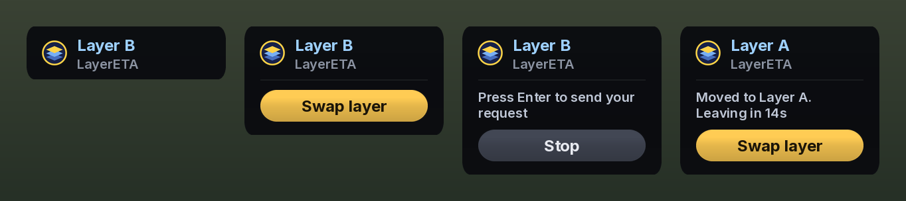

# LayerETA

**LayerETA swaps layer with one click.**

Part of the ETA family with [LevelETA](https://github.com/Nielsen2211/LevelETA) and [GoldETA](https://github.com/Nielsen2211/GoldETA). Same look, and each works on its own. All code in LayerETA is written for LayerETA. LayerETA uses its own hidden, password protected channel and its own message format.

## How a swap works

In WoW you change layer by joining a group whose leader stands on another layer in the same zone. The game then moves you, and you can leave again.

1. Click **Swap layer** (big view) or **Swap** (small view). A click elsewhere on the box switches between the big and the small view; each character remembers its own.
2. LayerETA sends a short request in its own hidden channel. Players who run LayerETA with **Host for others** on, and stand in your zone, can invite you. If no LayerETA host has invited you within 3 seconds, it also looks up the players in your zone with /who and asks them for an invite in a hidden whisper, so players who host with other layer addons can invite you. With `/leta channel` turned on, the click also writes `inv` in the public layer channel; that is off by default.
3. LayerETA accepts the first invite and tells the other hosts it is taken. It all happens in silence: no invite window, and the game's group lines (joins, leaves, loot rules) stay out of your chat while you swap or host.
4. **Moved?** The game tells addons when it moves you. LayerETA counts the swap and leaves the group a few seconds later.
5. **Not moved?** After 3 seconds LayerETA looks at how the game marks the host in your group. No mark means the host stands on your layer: LayerETA leaves and skips that host for 15 minutes. Marked as on another layer means the game refused to move you, try again in a little while.

Since 20 November 2026 WoW Forever hides which layer anyone is on, so no addon can show your layer or take you to a chosen one.

## Hosting

The **Host for others** switch in the box (or `/leta host`) lets you help other LayerETA users. You only host while you are alone, out of combat and outside instances, at most 5 invites in 10 minutes. A guest who stays more than 40 seconds is left behind when you leave the little group. Hosting is on by default, and one click on the switch turns it off. Off stays off for that character, across reloads, logins and updates, until you turn it on again. While you host, a player you invite is in your group for a few seconds: XP and loot from a kill in those seconds are shared as in any group. You never host while you are in a group of your own.

Players who host get priority: when you host yourself and ask for a swap, LayerETA hosts answer you first, and the last invite a host has left in its 10 minutes is kept for fellow hosts.

## 15 swaps an hour, never the same host twice

LayerETA allows 15 swaps in a rolling hour per character (also across a login). When they are used, the button shows *Wait* with the time left. A host that invited you is not used again for an hour, so your swaps spread over many hosts. A host that turned out to stand on your layer is skipped for 15 minutes.

## Commands

- `/leta` show or hide the box
- `/leta swap` same as the Swap button
- `/leta big` or `/leta small` big or small view
- `/leta host` host for others on or off
- `/leta channel` also write `inv` in the layer channel, on or off (off by default)
- `/leta others` also ask other hosts in your zone, on or off
- `/leta lock` lock or unlock the position
- `/leta leave <seconds>` how long to stay in the group after the move
- `/leta debug` what the addon sees right now
- `/leta da` or `/leta en` Danish or English

## License

Copyright (c) 2026 Rasmus. All Rights Reserved. See [LICENSE](LICENSE). The Inter fonts are under the SIL Open Font License.
